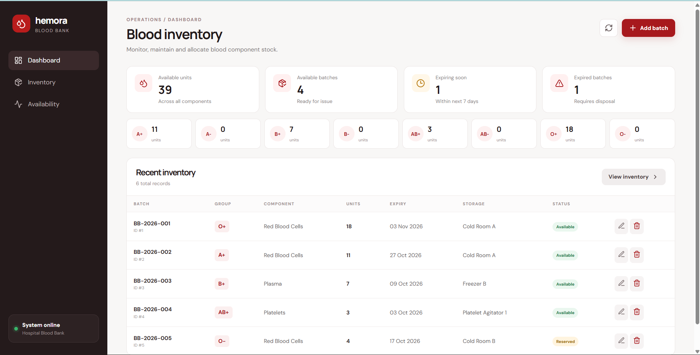
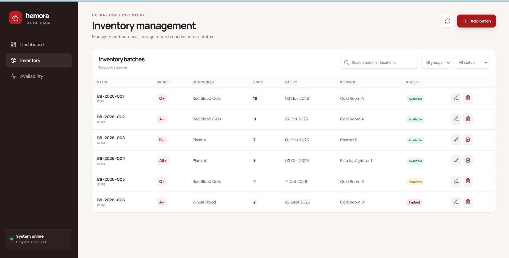
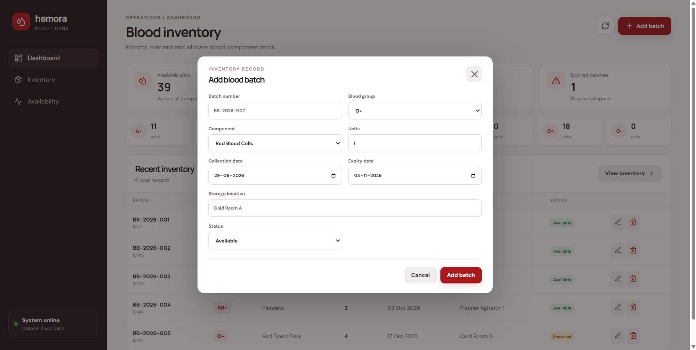
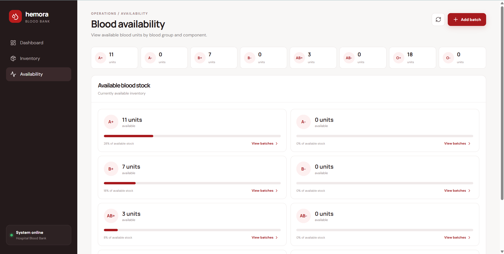
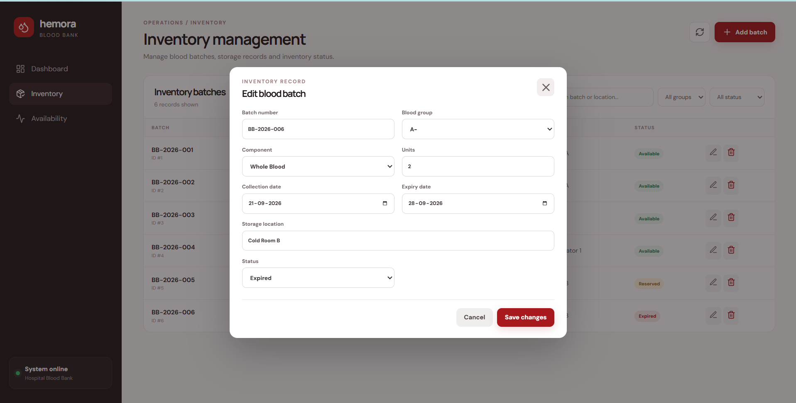

# Hemora — Hospital Blood Bank Inventory Management System

Hemora is a full-stack hospital blood bank inventory management application built to model a practical blood-bank workflow. It provides a centralized interface for monitoring blood stock, managing individual blood batches, tracking expiry and storage information, and viewing availability by blood group.

The application uses **Spring Boot** for the backend, **PostgreSQL** for persistent storage, and **React + Vite** for the frontend. PostgreSQL can be started through Docker Compose so that the development environment is reproducible.

---

## 1. Project Overview

Blood banks need to maintain accurate records of collected blood components because stock is time-sensitive and must be tracked by blood group, component type, quantity, storage location, status, and expiry date.

Hemora provides a simple operational system for these activities.

### Main capabilities

- Blood inventory dashboard
- Blood-group-wise stock summary
- Inventory batch management
- Add, edit and delete inventory records
- Search by batch number or storage location
- Filter by blood group
- Filter by inventory status
- Expiry and expiring-soon indicators
- Availability view for all eight blood groups
- PostgreSQL persistence
- REST APIs using Spring Boot
- React-based frontend
- Docker Compose support for PostgreSQL

---

## 2. Application Screens

### Dashboard

The dashboard provides an operational overview of the blood bank inventory, including available units, available batches, expiring batches, expired batches and blood-group-wise availability.



### Inventory Management

The inventory page provides the complete batch-level view with search, blood-group filtering, status filtering, editing and deletion.



### Add Blood Batch

New blood inventory can be entered through the batch creation form.



### Blood Availability

The availability page presents the currently available units for each blood group and allows the user to navigate directly to matching inventory records.



### Edit Blood Batch

Existing inventory records can be modified without leaving the inventory interface.



---

## 3. System Architecture

```text
                         ┌─────────────────────────┐
                         │       React Frontend    │
                         │       Vite + UI         │
                         │                         │
                         │ Dashboard               │
                         │ Inventory               │
                         │ Availability            │
                         └────────────┬────────────┘
                                      │
                                HTTP / REST
                                      │
                                      ▼
                         ┌─────────────────────────┐
                         │    Spring Boot Backend  │
                         │                         │
                         │ Controllers             │
                         │ Services                │
                         │ JPA Repositories       │
                         │ Validation / Logic      │
                         └────────────┬────────────┘
                                      │
                                  JDBC / JPA
                                      │
                                      ▼
                         ┌─────────────────────────┐
                         │      PostgreSQL 16      │
                         │                         │
                         │ Blood Inventory         │
                         │ Persistent Records      │
                         └─────────────────────────┘
                                      ▲
                                      │
                              Docker Compose
```

---

## 4. Technology Stack

| Layer | Technology |
|---|---|
| Frontend | React |
| Frontend tooling | Vite |
| Backend | Spring Boot 3.5.6 |
| Language | Java 21 |
| Persistence | Spring Data JPA / Hibernate |
| Database | PostgreSQL 16 |
| Database environment | Docker Compose |
| Build tool | Apache Maven 3.9.16 |
| API style | REST |
| Development environment | Visual Studio Code |

---

## 5. Core Domain Model

Each inventory record represents a blood batch.

The main information tracked for a batch is:

| Field | Description |
|---|---|
| ID | Internal database identifier |
| Batch Number | Unique identifier for the blood batch |
| Blood Group | A+, A-, B+, B-, AB+, AB-, O+, O- |
| Component Type | Blood component stored in the batch |
| Units | Number of available units in the batch |
| Collection Date | Date on which the blood was collected |
| Expiry Date | Date after which the batch is no longer usable |
| Storage Location | Physical storage location |
| Status | Current inventory state |

Example records used during testing included batch numbers such as:

```text
BB-2026-001
BB-2026-002
BB-2026-003
BB-2026-004
BB-2026-005
BB-2026-006
```

---

## 6. Inventory Status

The application supports inventory states including:

- `AVAILABLE`
- `RESERVED`
- `QUARANTINED`
- `EXPIRED`

These states allow the dashboard and inventory table to distinguish stock that is ready for issue from stock that is reserved or cannot currently be issued.

---

## 7. Dashboard Logic

The dashboard obtains its values from the backend rather than hard-coding them in the frontend.

The dashboard currently exposes:

- Total inventory batches
- Available batches
- Reserved batches
- Expiring-soon batches
- Expired batches
- Total available units
- Available units grouped by blood group

During the application test run, the backend returned:

```text
Total batches:        6
Available batches:    4
Reserved batches:     1
Expiring soon:        1
Expired batches:      1
Available units:     39
```

Available units by blood group in the tested dataset:

```text
A+    11
A-     0
B+     7
B-     0
AB+    3
AB-    0
O+    18
O-     0
```

These values are calculated from the persisted inventory records.

---

## 8. REST API

The frontend communicates with the Spring Boot backend through REST endpoints.

### Inventory

| Method | Endpoint | Purpose |
|---|---|---|
| GET | `/api/inventory` | Retrieve inventory batches |
| POST | `/api/inventory` | Create a new blood batch |
| PUT | `/api/inventory/{id}` | Update an existing batch |
| DELETE | `/api/inventory/{id}` | Delete an inventory batch |
| GET | `/api/inventory/dashboard` | Retrieve dashboard statistics |

The application was tested directly through the browser using:

```text
http://localhost:8080/api/inventory
```

and:

```text
http://localhost:8080/api/inventory/dashboard
```

The API returned real records from PostgreSQL.

---

## 9. Frontend Features

### Dashboard

The dashboard provides:

- Inventory summary cards
- Blood-group availability
- Recent inventory
- Direct navigation to the complete inventory

### Inventory

The inventory management screen supports:

- Displaying all batches
- Searching by batch number
- Searching by storage location
- Blood-group filtering
- Status filtering
- Adding a batch
- Editing a batch
- Deleting a batch

### Availability

The availability screen provides a blood-group-wise view of currently available units.

For each blood group, the interface displays:

- Available units
- Percentage of available stock
- Navigation to matching inventory records

The **View batches** action takes the user to the inventory screen with the relevant filters applied.

---

## 10. CRUD Workflow

The application was tested through a complete CRUD workflow.

### Create

A new batch can be entered using the **Add batch** form.

Example:

```text
Batch Number:   BB-2026-007
Blood Group:    O-
Component:      Red Blood Cells
Units:          6
Storage:        Cold Room B
Status:         Available
```

### Read

The newly created record appears in the inventory table and is retrieved through the REST API.

### Update

The edit action opens the same record in an editable form. Changes are persisted through the backend.

### Delete

The delete action requests confirmation and then removes the record through the REST API.

---

## 11. Search and Filtering

Inventory records can be filtered using:

### Search

```text
Batch Number
Storage Location
```

### Blood Group

```text
A+
A-
B+
B-
AB+
AB-
O+
O-
```

### Status

```text
Available
Reserved
Quarantined
Expired
```

The filtering is performed in the frontend using the inventory data retrieved from the backend.

---

## 12. Expiry Tracking

Expiry is an important part of a blood-bank inventory system.

The application distinguishes:

- Available stock
- Expiring-soon stock
- Expired stock

The dashboard displays separate indicators for expiring and expired batches.

This allows inventory staff to identify time-sensitive stock without manually checking every batch.

---

## 13. Backend Structure

The Spring Boot backend follows a layered architecture:

```text
Controller
    ↓
Service
    ↓
Repository
    ↓
PostgreSQL
```

### Controller

Handles HTTP requests and exposes REST endpoints.

### Service

Contains application-level business logic such as inventory aggregation and dashboard calculations.

### Repository

Uses Spring Data JPA to communicate with PostgreSQL.

### Entity

Represents the inventory record stored in the database.

This separation keeps HTTP handling, business logic and persistence responsibilities independent.

---

## 14. Frontend ↔ Backend Communication

The React application does not directly access PostgreSQL.

The communication flow is:

```text
User
  ↓
React UI
  ↓
REST API
  ↓
Spring Boot Controller
  ↓
Service Layer
  ↓
Spring Data JPA
  ↓
PostgreSQL
```

For example, opening the dashboard causes the frontend to request both inventory data and dashboard statistics from the Spring Boot API.

---

## 15. Database

PostgreSQL is used as the persistent database.

The development database is started through Docker Compose.

The tested environment used:

```text
PostgreSQL 16.14
```

The backend successfully established a HikariCP database connection during testing.

---

## 16. Running the Application

### Prerequisites

Install:

- Java 21
- Apache Maven 3.9+
- Node.js and npm
- Docker Desktop

Verify Java:

```powershell
java -version
```

Verify Maven:

```powershell
mvn -version
```

---

### Step 1 — Clone the repository

```powershell
git clone <YOUR_GITHUB_REPOSITORY_URL>
cd BloodBankInventorySystem
```

---

### Step 2 — Start PostgreSQL

From the project root:

```powershell
docker compose up -d
```

Check the running containers:

```powershell
docker ps
```

---

### Step 3 — Start the Spring Boot backend

Open a terminal:

```powershell
cd backend
mvn spring-boot:run
```

The backend runs on:

```text
http://localhost:8080
```

---

### Step 4 — Start the frontend

Open another terminal:

```powershell
cd frontend
npm install
npm run dev
```

The Vite development server runs on:

```text
http://localhost:5173
```

Open the URL in a browser.

---

## 17. Development Environment

The application was developed and tested using:

```text
Windows 11
Java 21
Maven 3.9.16
Spring Boot 3.5.6
PostgreSQL 16.14
Vite 7.3.6
```

The frontend development server was successfully started at:

```text
http://localhost:5173/
```

---

## 18. Testing Performed

The following functional tests were completed successfully.

| Test | Result |
|---|---|
| Spring Boot startup | Passed |
| PostgreSQL connection | Passed |
| Inventory API | Passed |
| Dashboard API | Passed |
| Frontend startup | Passed |
| Dashboard navigation | Passed |
| Inventory navigation | Passed |
| Availability navigation | Passed |
| Inventory search | Passed |
| Blood-group filtering | Passed |
| Status filtering | Passed |
| Add batch | Passed |
| Edit batch | Passed |
| Delete batch | Passed |
| Availability → filtered inventory | Passed |

The application was therefore tested across both the frontend and backend rather than only checking whether the UI loads.

---

## 19. Project Structure

```text
BloodBankInventorySystem/
│
├── backend/
│   ├── src/
│   │   └── main/
│   │       ├── java/
│   │       └── resources/
│   └── pom.xml
│
├── frontend/
│   ├── src/
│   ├── public/
│   ├── package.json
│   └── vite.config.*
│
├── docs/
│   └── screenshots/
│
├── .github/
├── docker-compose.yml
├── ARCHITECTURE.md
├── RUN.md
├── .gitignore
└── README.md
```

---

## 20. Screenshots and Implementation Evidence

The repository contains screenshots of:

- Dashboard
- Inventory management
- Add batch form
- Availability dashboard
- Edit batch form
- Frontend development server
- Spring Boot backend startup

These screenshots document the application as it was actually executed during development.

---

## 21. Future Enhancements

The current application focuses on inventory management. A production-oriented version could additionally include:

- Authentication and role-based access
- Donor management
- Hospital/request management
- Blood issue and transfusion workflows
- Blood reservation
- Automatic expiry notifications
- Low-stock alerts
- Audit logs
- Barcode/QR-based batch identification
- Email/SMS notifications
- Advanced reporting
- Multi-hospital inventory synchronization
- Role-specific dashboards
- Deployment using Docker and cloud infrastructure

---

## 22. Purpose of the Project

Hemora was developed as a real-world Spring Boot application rather than a basic CRUD demonstration. The implementation combines a practical domain model, persistent database storage, REST APIs, frontend state management, filtering, aggregation and CRUD workflows into one working system.

The project demonstrates:

- Spring Boot REST API development
- Spring Data JPA
- PostgreSQL database integration
- Layered backend architecture
- React frontend development
- REST-based frontend/backend integration
- Docker-based database setup
- CRUD operations
- Business-oriented dashboard calculations
- Real-world inventory management concepts

---

## License

This project is intended for academic and portfolio purposes.
